# dsh-chat-replica

A DeepSeek chat-demo style conversation UI for [DeepSeek Harness](https://github.com/deepseek-ai/deepseek-harness) (DSH): session sidebar, message bubbles, composer, file upload, voice input and read-aloud. Every color comes from DSH theme tokens, so the light and dark themes follow automatically.

**English** | [简体中文](README.md)

> **Unofficial project.** Not affiliated with, endorsed by, or connected to DeepSeek or DeepSeek Harness.
> The layout and copy reference DeepSeek's public chat-demo page and are used for study and personal use only;
> trademarks and assets belong to their respective owners. Model access uses the models and keys you configured
> **in your own DSH** — this project ships no credentials.

## Preview

The "⋯" menu on every conversation (dark theme):

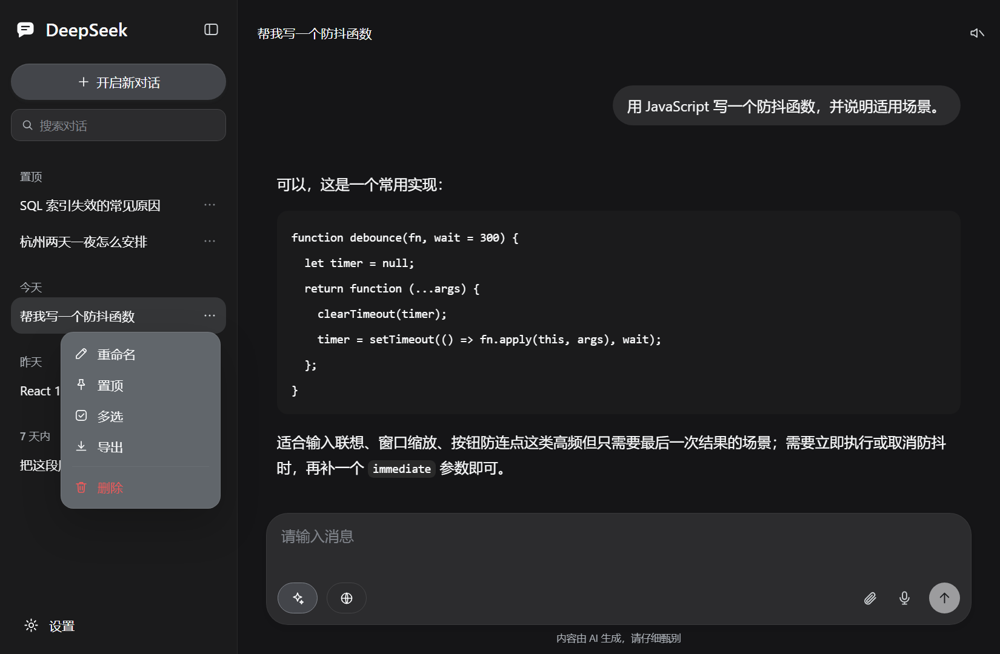

Delete confirmation (dark theme):

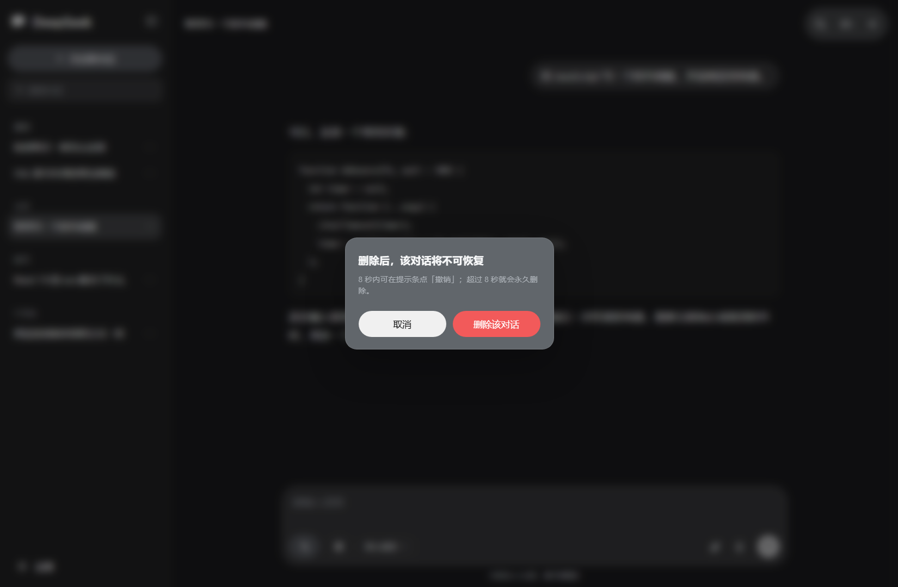

Editing a user message and re-answering (dark theme):

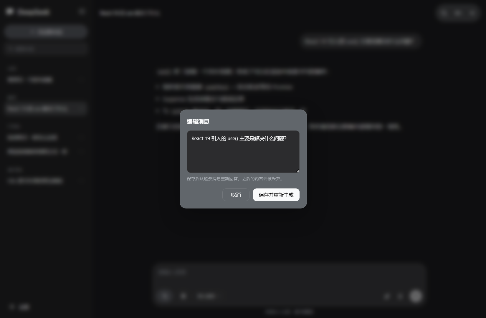

A conversation forked from an answer (dark theme):

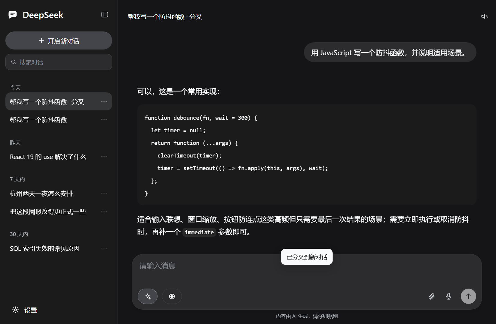

Find in a conversation: press Ctrl/Cmd+F, matches are highlighted, and the current match is marked solid.

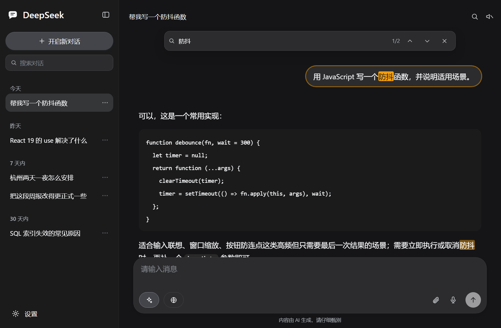

Usage mirrors DSH: every answer ends with this turn's `↑ billed input · ↓ output` (hover for cache hit and
reasoning tokens), and the ring on the right of the composer shows context occupancy (hover for
`~used / window`). Click the usage line or the ring to open the breakdown.

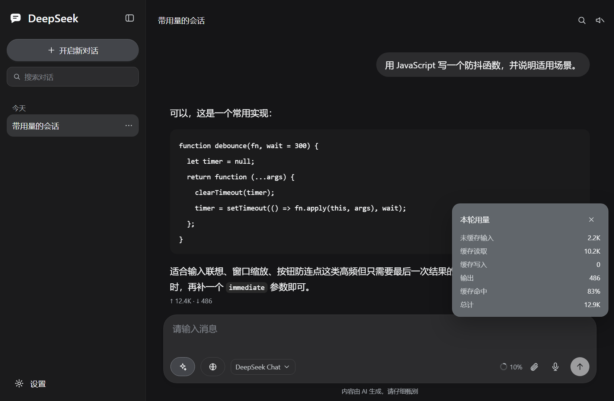

The context panel splits the prompt by origin: system prompt / conversation / tool calls (this plugin has no
tools, so that part stays 0); the split is estimated by the Host's `{type:'context'}` frame.

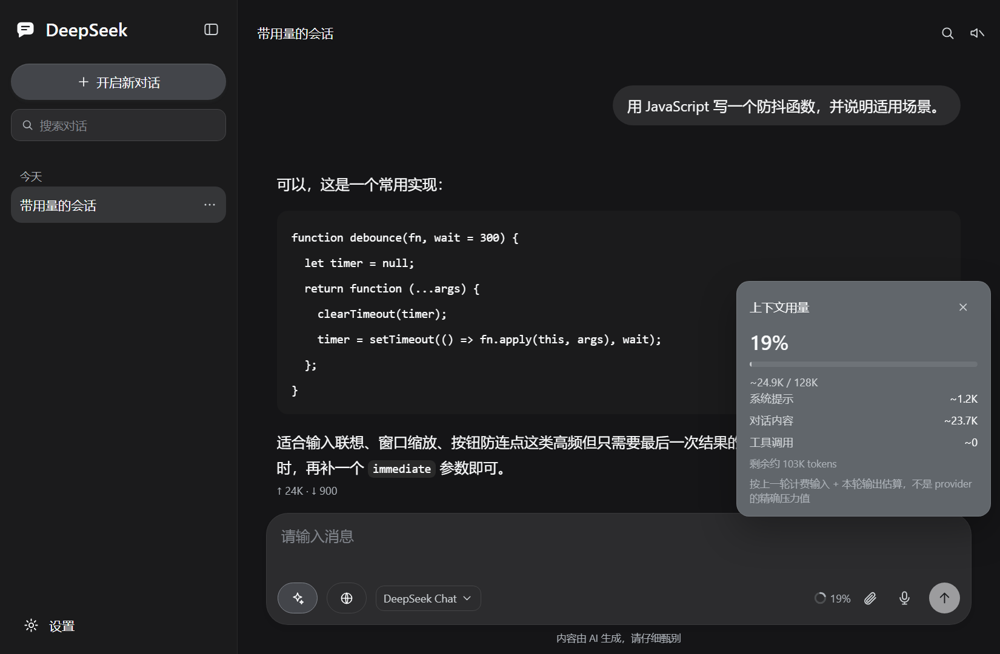

Model picker: the composer shows the current model; open it to switch between providers, or go back to the default.

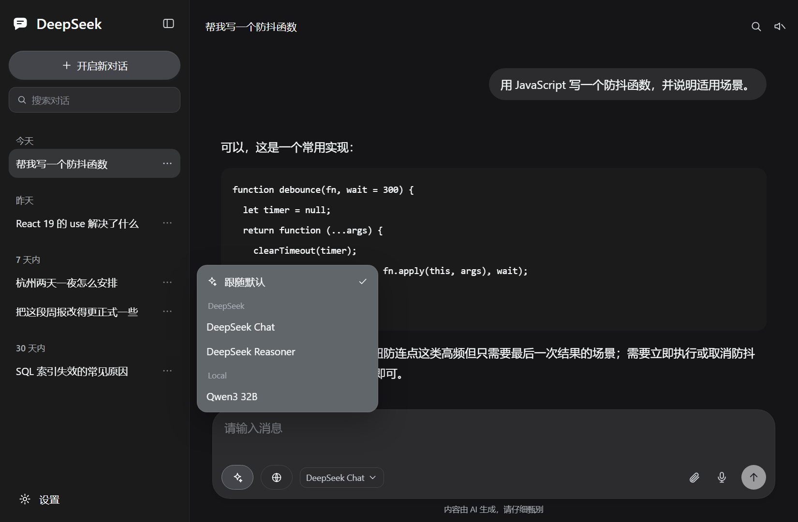

Settings: theme, text size and language, with the version, repository link and "check for updates" in the footer.

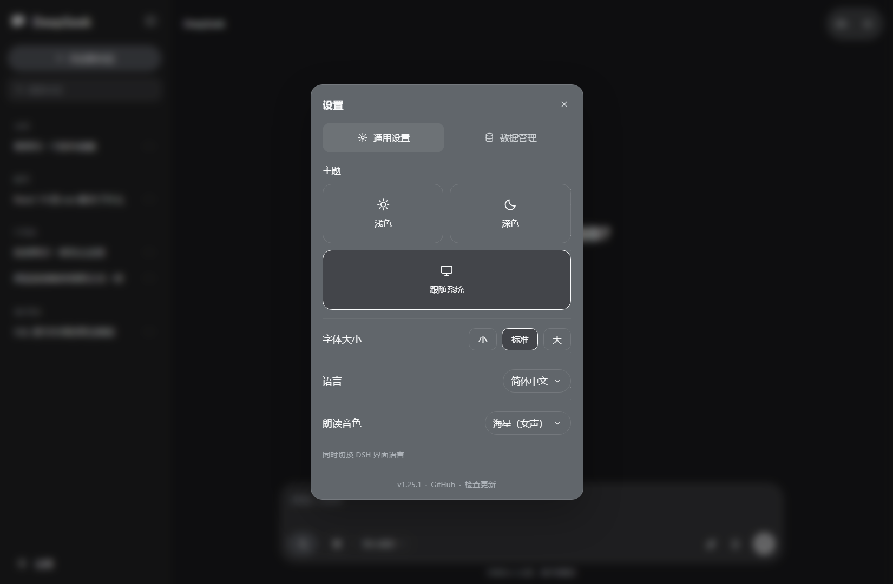

Light theme:

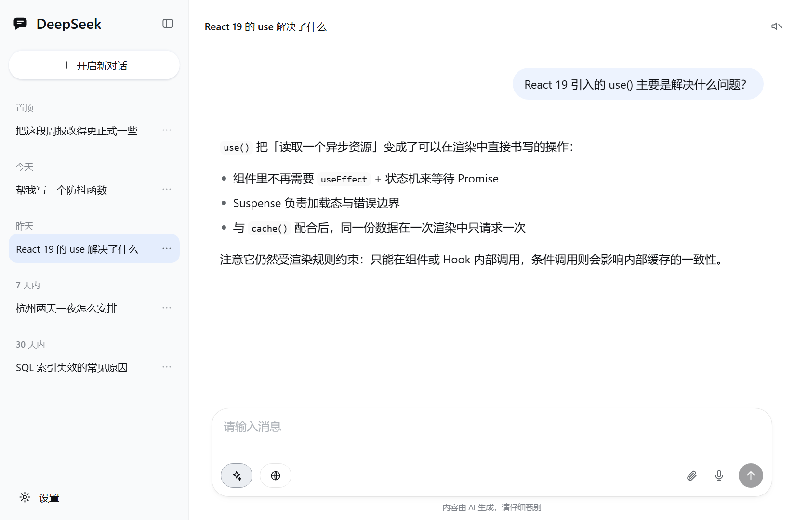

## Features

- Conversation sidebar grouped by Today / Yesterday / Previous 7 days / Previous 30 days, persisted locally; the `☰` capsule opens the drawer and `＋` starts a new conversation
- Conversation search filters titles and message bodies; Enter opens the first match, while Esc or the clear button in the field restores the full list
- Drafts are stored per conversation: half a sentence typed in A never shows up in B, and it survives leaving the panel
- Keyboard support: arrow keys / Home / End navigate the menu, F2 renames and Delete deletes a focused conversation, and Tab stays inside dialogs with focus restored on close
- Every message carries its local time (`HH:MM`), shown with the action buttons on hover or on touch
- Any answer can be forked: the conversation is copied up to that answer into a new one titled "· fork", so you can continue in another direction; pin state is not inherited
- A user message can be edited and re-answered: saving truncates to that message and discards what follows (Ctrl/Cmd+Enter saves, Esc cancels)
- A single conversation can be exported as a **Markdown** reading copy; JSON remains the backup and re-import format
- The top-right capsule is always there (find / read-aloud / new chat); both the sidebar toggle and the find button enter or leave with a `0.28s linear` horizontal animation, so starting a new chat collapses the find button smoothly
- The sidebar itself slides too: its width transitions between 0 and 261px over 0.28s linear, in sync with the capsule
- Find in a conversation: Ctrl/Cmd+F highlights matches, marks the current one solid, Enter / Shift+Enter jump, Esc closes
- Model picker: the composer shows the current model; switch per provider or fall back to the default. The choice is stored locally and sent with each request; an unknown model falls back to the default
- The settings footer can check for updates: it queries the latest GitHub release only when clicked and shows up-to-date / a new version (click again to open it) / a failed check
- Usage matches DSH: every answer ends with this turn's `↑ billed input · ↓ output`, the composer ring shows context occupancy, and hovering reveals cache-hit and reasoning tokens
- Clicking the usage line opens this turn's breakdown (uncached input / cached input / cache write / output with reasoning / cache hit / total); clicking the ring opens the context panel (percentage, bar, `~used / window`, remaining tokens, split by origin)
- Exports carry usage: JSON keeps each turn's `usage` (and restores it on import), and Markdown appends `_用量：↑ … · ↓ … · 缓存命中 …%_` after every answer
- Message bubbles, welcome screen, composer, Markdown (headings / lists / inline code / code blocks) and a collapsible "Thought" block
- Upload text files, voice input, send / stop on the right of the composer
- "Deep thinking" maps to the model's reasoningEffort (on = max, off = off; levels come from the model declaration)
- "Smart search" queries `ctx.web.search()` first, then puts the first two pages of text into the system prompt; answers carry source links
- Read-aloud through the official TTS proxy, with two voices: Stella (female) and Tide (male); each answer has play / stop buttons
- Settings panel with two swipeable tabs:
  - General: theme (light / dark / follow system), text size (small / standard / large, 14 / 16 / 18 px, affecting message text and the composer only), language (Simplified Chinese / English, which also switches the DSH UI language), read-aloud voice and auto-read
  - Data: import history, export history, export folder, delete all conversations
  - The footer shows the version and a GitHub repository link (opened in a new tab)
- Conversation list actions behind the "⋯" on each row: rename, pin, multi-select (bulk pin / delete), delete with confirmation

### Conversation list menu

The "⋯" on the right of every conversation opens:

| Item | Behavior |
| --- | --- |
| Rename | Dialog to edit the title: Enter saves, Esc cancels; the title is stored in localStorage and survives export / import |
| Pin | Pinned conversations form their own group above all date groups, most recently pinned first; pinned rows offer "Unpin" |
| Select | Enters multi-select: every row becomes a checkbox and clicking toggles it; the toolbar offers select-all / clear-all (over the current filter), bulk pin, bulk export and bulk delete, and Escape leaves |
| Export JSON | Writes this conversation as JSON (a backup you can import again) and reports the result in the toast |
| Export Markdown | Writes this conversation as a `.md` reading copy — title, time and user / assistant sections — into the export folder |
| Delete | Two-step confirmation; the conversation is removed immediately and gets an **8-second** undo, after which it is permanent |

The delete confirmation is intentionally fixed in wording and styling:

1. Title: `This conversation cannot be restored after deletion` (multi-select: `The selected N conversations cannot be restored after deletion`)
2. A note under the title: `You can undo within 8 seconds from the toast; after that it is permanent.`
3. Red pill with white text: `Delete conversation`
4. Light-grey pill with black text: `Cancel`, focused by default, so pressing Enter cancels

After confirming, a toast stays for **8 seconds** with an "Undo" action: undoing restores the deleted
conversations, their drafts and the conversation that was open at the time. After 8 seconds — or once another
deletion replaces the snapshot — the conversations are gone for good.

Pin state lives in the thread's `pinnedAt` field (the same `deepseek-chat-ui.threads.v1` store), so it survives
reloads and app restarts; records without the field are simply not pinned.

Rename, pin and delete are structural changes and are written to localStorage **immediately** (streaming answers
still use a 400 ms debounce), plus one extra snapshot on unmount. Leaving the panel right after deleting a
conversation therefore no longer resurrects it, and an emptied list stays empty instead of falling back to the
demo conversations.

## Requirements

- A DSH installation with the Web UI and plugin system (Desktop build, or a `dsh` web profile)
- **DSH ≥ 0.2.1-rc.2** (`engines.dsh` is `>=0.2.1-rc.2 <0.3.0`). On 0.2.1-rc.2 we verified
  `llm.listProviders` / `llm.listModels` / `llm.resolveModelInfo`, `agentDefaultModel.currentSelection` and
  prefix route registration. If an addition from a later release is missing, the matching feature degrades
  silently (for example, without a model catalog the picker only offers "Use default")
- Model, speech recognition and read-aloud reuse the `llm` / `speechToText` / `DEEPSEEK_API_KEY` already
  configured in your DSH; the plugin stores no credentials of its own

## Install

The fastest way: download the latest `dsh-chat-replica-<version>.tar.gz` from
[Releases](https://github.com/AlphaAntivoid/dsh-chat-replica/releases/latest), then in DSH open
**Plugins → Install → pick the tarball**, refresh the page, and click the **Chat mode** panel icon in the
sidebar. The page fills the main panel.

You can also build the bundle from source (this repository is the package itself, `package.json` at the root;
the Plugin Manager expects a tarball with one folder at its root):

```sh
git clone https://github.com/AlphaAntivoid/dsh-chat-replica.git
cd ..
tar -czf dsh-chat-replica.tar.gz dsh-chat-replica
```

Then install that `dsh-chat-replica.tar.gz`.

### Manual install

Copy the repository into the current profile's `node_modules` and append an insert row to that profile's
`cordis.patch.yml`:

```yaml
- insert:
    - id: deepseek-chat-ui
      name: '@local/deepseek-chat-ui'
```

Restart DSH to take effect. To uninstall, remove that insert and the
`node_modules/@local/deepseek-chat-ui` directory.

> The package name stays `@local/deepseek-chat-ui` (a local scope; it is not published to npm). It is also the
> plugin's module id inside DSH, so renaming it would also touch `cordis.patch.yml`, `locale/*.json` and the
> profile's installed record.

## Development

- The plugin has two halves: `index.js` runs in the Host (Node), `client.js` runs in the browser. The latter is
  loaded directly by DSH's client module system — there is no build step.
- A profile with client-hmr enabled hot-reloads the plugin when `client.js` changes; restart DSH if it does not.
- Theme colors must come from `--dsw-alias-*` / `--dsw-specific-*` tokens. Do not hard-code colors, except for
  the deliberate light-grey / black "Cancel" pill in the delete confirmation.
- Local checks: `npm test` (headless render regressions, stylesheet integrity, package metadata);
  `npm run bundle` writes `dist/dsh-chat-replica-<version>.tar.gz`.
- Why the long conversation list is not windowed, plus measurements and thresholds:
  [docs/PERF.md](docs/PERF.md).
- Releasing: update `CHANGELOG.md` and `version` in `package.json`, then push a `v<version>` tag; GitHub Actions
  runs the tests, builds the bundle and creates the Release.

## Layout

| File | Purpose |
| --- | --- |
| `index.js` | Host half: `/chat-replica/chat` (NDJSON model stream), `/chat-replica/models` (provider / model catalog), `/chat-replica/update` (latest release lookup), `/chat-replica/transcribe` (16 kHz WAV to text), `/chat-replica/tts` (read-aloud PCM proxy), `/chat-replica/system-theme`, `/chat-replica/paths` (export folder shortcuts), `/chat-replica/export` (writes JSON or Markdown) |
| `client.js` | Browser half: the `main` page plus the `sidebar.panellist` icon, with CSS, the Chinese and English dictionaries, Markdown, recording and upload |
| `cordis.patch.yml` | Bundle patch, read by the Plugin Manager at install time |
| `locale/zh.json`, `locale/en.json` | Name and description shown in the Plugin Manager |
| `icon.svg` | Plugin icon |

## Architecture

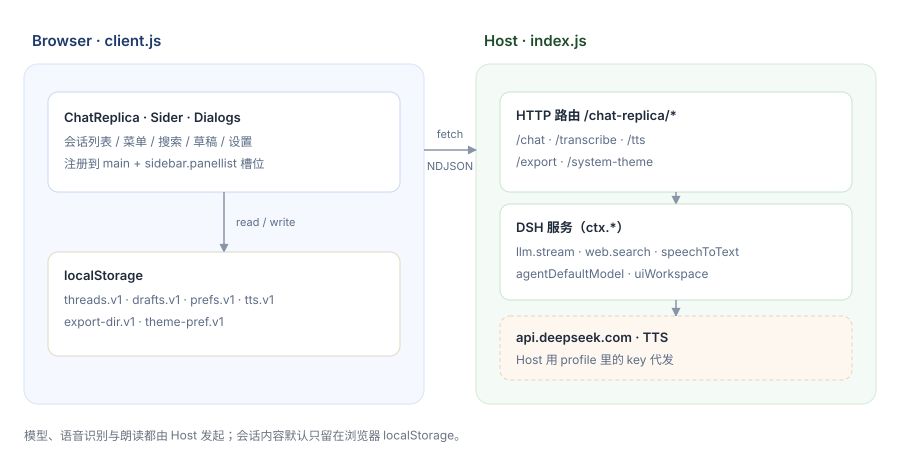

- The browser half (`client.js`) owns rendering: conversation list, menu, search, dialogs
- Conversations, drafts and preferences live in the browser's `localStorage` and are not uploaded by default
- The host half (`index.js`) serves `/chat-replica/*` routes and only calls services DSH already composed
  (`llm.stream` / `web.search` / `speechToText` / `agentDefaultModel` / `uiWorkspace`)
- Read-aloud requests are proxied by the Host with the key from your profile to `api.deepseek.com`

## How it works

1. The page sends `POST /chat-replica/chat` with `{messages:[{role,text}], thinking, search, query, model?}`;
   `model` is the page's `{provider, model}` choice and is absent when following the profile default.
2. The Host validates a page choice with `resolveModelInfo()`: a known model wins, anything else falls back to
   `agentDefaultModel.currentSelection()`, and the stream starts with a `{type:'model'}` frame reporting the
   actual selection. With search on, the Host calls `web.search()` first (streaming `search:start/done` frames
   back to the page) and fetches the first two pages; then it picks the reasoningEffort from the toggle and
   calls `ctx.llm.stream()`, writing `text-delta` / `reasoning-delta` as NDJSON lines.
3. The page folds the deltas into message bubbles; `reasoning` renders as a collapsible "Thought" block.
   Stopping aborts the request, which cancels the model stream on the Host.
4. Voice: the page records 16 kHz mono PCM with Web Audio, wraps it in a WAV container and uploads it; the Host
   uses the `speechToText` provider.
5. Conversations live in `localStorage` (`deepseek-chat-ui.threads.v1`); toggles in
   `deepseek-chat-ui.prefs.v1`; text size in `deepseek-chat-ui.font.v1`; read-aloud settings (voice + auto-read) in
   `deepseek-chat-ui.tts.v1`.
6. Read-aloud matches the web demo: `POST https://api.deepseek.com/v1/tools/tts` with
   `{text, voice_id: stella|tide, format: pcm, filter_markdown: true}` returns 24 kHz mono 16-bit PCM; the Host
   proxies the call with the profile's `DEEPSEEK_API_KEY` and the page schedules playback through
   `AudioContext(24000)`.
7. Export goes through `POST /chat-replica/export` (with `dir` and an optional `format` in the body): the Host
   writes `{version, exportedAt, threads}` to `<dir>/deepseek-chat-<local time>.json` (`format: 'markdown'`
   writes a `.md` reading copy instead). An empty `dir` lets the Host
   choose: the folder requested by the page when it is absolute and already exists, then Android's
   `/sdcard/Download` (only where that path exists), then the user's `Downloads` / `Download` / `Documents`
   (created when missing); the response's `dir` is where the file really landed. JSON responses carry
   `cache-control: no-store, no-transform`, because the carrier's gzip rewrite sends headers early and the
   browser reports "Failed to fetch". The "export folder" row uses `uiWorkspace.listDirectory()` for the built-in
   file browser and stores the choice in `deepseek-chat-ui.export-dir.v1`. Import reads the same shape (a bare
   array is accepted too).
8. Usage: `llm.stream`'s `usage` chunk becomes a `{type:'usage', usage}` frame and the page stores it on that
   answer; the `{type:'model'}` frame carries `resolveModelInfo().context.contextWindow` (the `current` entry of
   `/models` carries it too), and the page draws the context ring from "last billed input + this turn's output ÷
   window". A `{type:'context'}` frame carries the per-origin estimate (system / messages / tools): CJK counts
   one token per character and ASCII one per four, used only for the segmented bar, never for billing.
9. Export: JSON keeps each message's `usage`; Markdown appends a `_用量：…_` line after an answer. Import only
   accepts numeric usage fields.

## Privacy

- Conversations stay in the browser's `localStorage` by default and are never uploaded to any service owned by
  this project.
- Model requests, speech recognition and read-aloud are all issued by **your own DSH Host**; read-aloud goes to
  `api.deepseek.com`'s TTS endpoint with the key in your profile.
- Exports are written to the directory you choose; the Host also appends each export result to
  `~/.dsh/chat-replica-export.log`.

## Known limitations

- Upload accepts text-like files only (≤512 KB, at most 5); PDF / Office / images are not parsed.
- Voice depends on the WebView's microphone permission and a `speechToText` provider; a missing one produces a hint.
- The speech model (SenseVoice, 163 MB) is downloaded on first use; offline recognition works once it is present.
- Switching the language writes DSH's own locale preference, so the whole UI (sidebar included) switches with it.
- Import skips duplicates: same title, update time, message count and first message means the same conversation, and the status line reports how many were skipped
- A full localStorage is surfaced as a "local storage is full" toast instead of silently dropping changes
- A render failure shows a fallback inside this panel (with retry) instead of blanking the whole page
- Only a single conversation can be exported as Markdown; bulk export and import still use JSON
- Context occupancy is an **approximation**: last billed input plus this turn's output, divided by the route's
  declared window. DSH has a token-meter pressure projection; this plugin has no equivalent live sampling. The
  segmented bar is likewise a character-count estimate (one token per CJK character, one per four ASCII
  characters), not a provider-exact tokenization

## Visual origin

Layout dimensions were taken from the chat-demo `main.css` (261 px sidebar, 24 px composer radius, 22 px bubble
radius, 712 / 840 px column widths, and so on) together with the `--dsw-alias-*` / `--dsw-specific-*` token
usage; copy comes from its i18n dictionary.

## License

[MIT](LICENSE) © 2026 AlphaAntivoid
