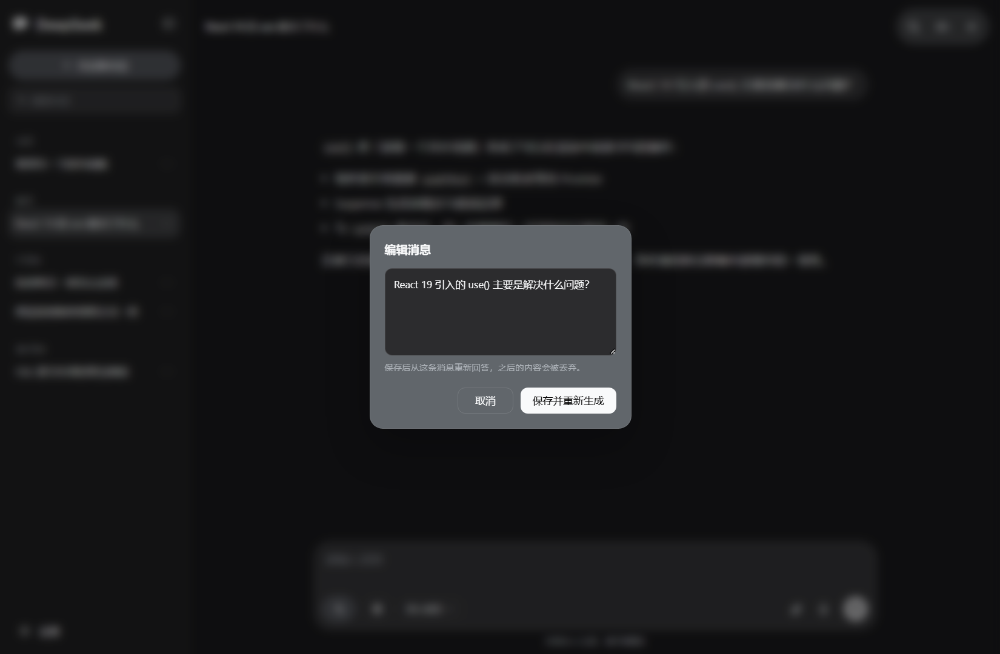
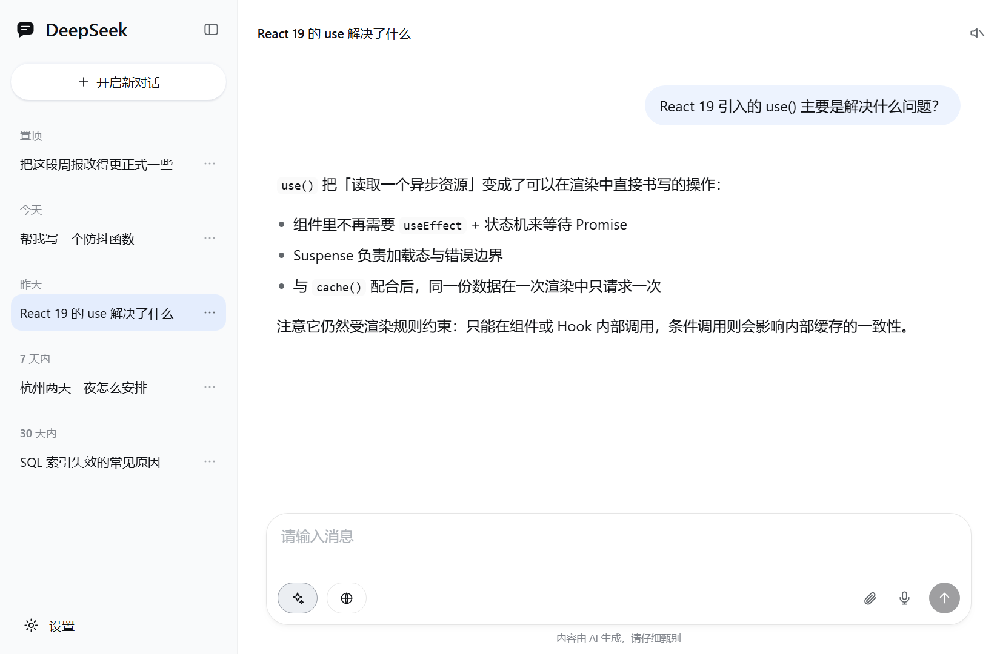

# dsh-chat-replica

[English](README.en.md) | **简体中文**

把 DeepSeek 网页版 chat-demo 的对话界面搬进 [DeepSeek Harness](https://github.com/deepseek-ai/deepseek-harness)（DSH）的插件：会话侧栏、消息气泡、输入框、上传与语音、朗读，颜色全部引用 DSH 主题令牌，自动跟随浅色 / 深色。

> **非官方项目。** 与 DeepSeek、DeepSeek Harness 官方没有任何关联，也不代表其立场。
> 界面布局与文案参考 DeepSeek chat-demo 的公开页面，仅作学习与自用；相关商标与素材归其权利人所有。
> 需要模型能力时调用的是**你自己 DSH 里配置的**模型与密钥，本项目不附带任何密钥。

## 预览

会话列表的「⋯」菜单（深色主题）：


删除的二次确认（深色主题）：


编辑用户消息并重新生成（深色主题）：



分叉出的新会话（深色主题）：


浅色主题：



## 功能

- 会话侧栏：按今天 / 昨天 / 7 天内 / 30 天内分组，本地持久化；右上角胶囊 `☰` 打开抽屉、`＋` 新建对话
- 会话搜索：按标题与消息全文过滤，回车直接打开第一条命中；Esc 或输入框里的清除按钮恢复全部
- 草稿按会话隔离：在 A 里打半句去 B 不会串，切走面板再回来也还在
- 键盘可用：菜单方向键 / Home / End 导航，行上 F2 重命名、Delete 删除，对话框内 Tab 循环且关闭后焦点还原
- 每条消息带本地时间（`HH:MM`），悬停或触屏时与操作按钮一起显示
- 任意一条回答可「分叉」：把会话复制到该回答为止生成新会话（标题带「· 分叉」），方便换个方向继续；分叉不继承置顶
- 用户消息可「编辑」并重新生成：保存后截断到该条、丢弃之后的内容（Ctrl/Cmd+Enter 保存，Esc 取消）
- 消息气泡、欢迎语、输入框，Markdown（标题 / 列表 / 行内代码 / 代码块）与「已思考」折叠块
- 输入框右侧：📎 上传文本文件、🎤 语音输入、发送 / 停止
- 「深度思考」映射到模型的 reasoningEffort（开 = max，关 = off，档位取自模型声明）
- 「智能搜索」先 `ctx.web.search()` 检索，再把前两条正文塞进系统提示，答案带来源链接
- 朗读：官方 TTS 代理，音色 海星（女声）stella / 暗潮（男声）tide；每条回答下方有朗读 / 停止
- 设置面板（两个分类，可左右滑动切换）：
  - 通用设置：主题（浅色 / 深色 / 跟随系统）、字体大小（小 / 标准 / 大，14 / 16 / 18 px，只影响消息正文与输入框）、语言（简体中文 / English，同时切换 DSH 界面语言）、朗读音色与自动朗读
  - 数据管理：导入历史对话 / 导出历史对话 / 导出位置 / 删除所有对话
  - 面板底部显示版本与 GitHub 仓库链接（在新标签打开）
- 会话列表右上角的「⋯」操作菜单：重命名、置顶、多选（批量置顶 / 删除）、二次确认删除

### 会话列表菜单

每条对话最右侧的「⋯」打开操作菜单：

| 菜单项 | 行为 |
| --- | --- |
| 重命名 | 弹窗改标题：回车保存、Esc 取消；标题写回 localStorage，导出 / 导入也会保留 |
| 置顶 | 单独成组排在所有日期分组之前（按置顶时间倒序）；已置顶的行显示「取消置顶」 |
| 多选 | 进入多选：每行变成复选框，点行切换选择；工具条可全选 / 取消全选（按当前筛选结果）、批量置顶、批量导出、批量删除，Esc 退出 |
| 导出 | 把这一条会话写成 JSON 到「导出位置」，结果显示为提示条 |
| 删除 | 二次确认；确认后立即移除，并在**8 秒内**提供「撤销」，超时即永久删除 |

删除确认的文案与样式固定：

1. 标题：`删除后，该对话将不可恢复`（多选时为「删除后，选中的 N 个对话将不可恢复」）
2. 红色气泡 + 白字：`删除该对话`
3. 灰白色 + 黑字：`取消`，默认聚焦，所以回车等于取消

确认后提示条会保留 **8 秒**，带一个「撤销」：撤销会恢复被删的会话、它们的草稿，以及当时正打开的那条。
超过 8 秒，或期间又删除了别的会话（撤销快照只保留最近一次），就真的不可恢复了。

置顶状态存在线程对象的 `pinnedAt` 字段里（与 `deepseek-chat-ui.threads.v1` 同一个存储），
因此刷新、重开 App 后仍然有效；旧数据没有该字段就是未置顶。

删除 / 置顶 / 改名为结构性改动，会**立刻**写入 localStorage（流式回答仍走 400 ms 防抖），
并且面板卸载时再补写一次快照。所以删掉对话后马上切到别的面板、再回来也不会“复活”；
对话删空后保存的是空数组，重新进入不会退回演示用的种子对话。

## 环境要求

- 一个带 Web UI 与插件系统的 DSH 安装（Desktop 版，或 `dsh` 的 web profile）
- 模型、语音识别、朗读分别复用 DSH 中已有的 `llm` / `speechToText` / `DEEPSEEK_API_KEY`，本插件不单独保存凭据

## 安装

最快的方式：从 [Releases](https://github.com/AlphaAntivoid/dsh-chat-replica/releases/latest) 下载最新的
`dsh-chat-replica-<version>.tar.gz`，然后打开 DSH → **插件 → 安装 → 选择该 tar.gz**，刷新页面，
侧栏会出现面板图标「对话模式」，点开即占满中间面板。

也可以自己从源码打包（本仓库就是插件包本体，`package.json` 在根目录；Plugin Manager 接受
「根目录包着一层文件夹」的 tarball）：

```sh
git clone https://github.com/AlphaAntivoid/dsh-chat-replica.git
cd ..
tar -czf dsh-chat-replica.tar.gz dsh-chat-replica
```

再在 DSH 里安装这个 `dsh-chat-replica.tar.gz`。

### 手动安装

把仓库目录放到当前 profile 的 `node_modules` 下，并在该 profile 的 `cordis.patch.yml` 末尾追加一行 insert：

```yaml
- insert:
    - id: deepseek-chat-ui
      name: '@local/deepseek-chat-ui'
```

重启 DSH 后生效。卸载时删掉这段 insert 与 `node_modules/@local/deepseek-chat-ui` 目录即可。

> 包名沿用 `@local/deepseek-chat-ui`（本地作用域，不发布到 npm）。它同时是插件在 DSH 里的模块 id，
> 改名会连带改 `cordis.patch.yml`、`locale/*.json` 与 profile 里已安装的记录。

## 开发

- 插件分两半：`index.js` 跑在 Host（Node），`client.js` 跑在浏览器；后者由 DSH 的 client 模块系统直接加载，
  没有构建步骤。
- 开着 client-hmr 的 profile 会在 `client.js` 落盘后自动热加载；没有生效就重启 DSH。
- 主题颜色只使用 `--dsw-alias-*` / `--dsw-specific-*` 令牌，不要在 CSS 里写死颜色（`#f0f0f0` 这类
  只用于「删除确认」里刻意要求灰白底黑字的按钮）。
- 本地检查：`npm test` 跑无头渲染回归、样式类完整性与包元数据；`npm run bundle` 产出
  `dist/dsh-chat-replica-<version>.tar.gz`。
- 长列表为什么不做虚拟滚动、实测数据与阈值建议见 [docs/PERF.md](docs/PERF.md)。
- 发版：更新 `CHANGELOG.md` 与 `package.json` 的 `version`，打 tag `v<version>` 并推送；GitHub Actions
  会自动跑测试、打包并创建 Release。

## 结构

| 文件 | 作用 |
| --- | --- |
| `index.js` | Host 半边：`/chat-replica/chat`（NDJSON 模型流）、`/chat-replica/transcribe`（16k WAV 转文字）、`/chat-replica/tts`（朗读 PCM 代理）、`/chat-replica/system-theme`、`/chat-replica/paths`（导出快捷目录）、`/chat-replica/export`（写 JSON 到指定目录） |
| `client.js` | 浏览器半边：`main` 页面 + `sidebar.panellist` 图标，内含 CSS、中英文字典、Markdown、录音与上传 |
| `cordis.patch.yml` | bundle 补丁（安装时由 Plugin Manager 读取） |
| `locale/zh.json`、`locale/en.json` | Plugin Manager 里显示的名称与描述 |
| `icon.svg` | 插件图标 |

## 架构


- 浏览器半边（`client.js`）负责全部渲染：会话列表、菜单、搜索、对话框
- 会话、草稿、偏好都存在浏览器 `localStorage`，默认不上传
- Host 半边（`index.js`）提供 `/chat-replica/*` 路由，内部只调用 DSH 已装配的服务
  （`llm.stream` / `web.search` / `speechToText` / `agentDefaultModel` / `uiWorkspace`）
- 朗读请求由 Host 用 profile 里的密钥代发到 `api.deepseek.com`

## 数据流

1. 页面 `POST /chat-replica/chat`，body 是 `{messages:[{role,text}], thinking, search, query}`。
2. 开关 search 时先 `web.search()`（并把 `search:start/done` 帧回传页面），再抓前两条正文；
   然后取 `agentDefaultModel.currentSelection()` 的 provider/model，按开关选 reasoningEffort，调用
   `ctx.llm.stream()`，把 `text-delta` / `reasoning-delta` 逐行写成 NDJSON。
3. 页面把增量折进消息气泡，`reasoning` 显示为可折叠的「已思考」块；停止生成会 abort 请求，
   Host 端随之取消模型流。
4. 语音：页面用 Web Audio 录 16 kHz 单声道 PCM，编成 WAV 上传；Host 走 `speechToText` provider。
5. 会话保存在 `localStorage`（`deepseek-chat-ui.threads.v1`），开关状态在 `deepseek-chat-ui.prefs.v1`，
   字体大小在 `deepseek-chat-ui.font.v1`，朗读设置（音色 + 自动朗读）在 `deepseek-chat-ui.tts.v1`。
6. 朗读与网页 demo 一致：`POST https://api.deepseek.com/v1/tools/tts`，
   `{text, voice_id: stella|tide, format: pcm, filter_markdown: true}`，返回 24 kHz 单声道 16 位 PCM；
   Host 用 profile 里的 `DEEPSEEK_API_KEY` 代发，页面按 `AudioContext(24000)` 排程播放。
7. 导出走 `POST /chat-replica/export`（body 里带 `dir`）：Host 把 `{version, exportedAt, threads}`
   写成 `<dir>/deepseek-chat-<本地时间>.json`。`dir` 留空表示交给 Host 选：优先用页面给的目录（必须已存在），
   其次是 Android 的 `/sdcard/Download`（仅在该路径存在时），再退到用户的 `Downloads` / `Download` /
   `Documents`（不存在会自动创建）；响应里的 `dir` 就是实际写入位置。
   JSON 响应统一带 `cache-control: no-store, no-transform`：carrier 的 gzip 重写会提前发送响应头，
   导致浏览器报「Failed to fetch」。
   页面里的「导出位置」用 `uiWorkspace.listDirectory()` 做内置文件浏览，选择结果存在
   `deepseek-chat-ui.export-dir.v1`。导入读同一格式（也接受裸数组）。

## 隐私

- 对话内容默认只存在浏览器 `localStorage`，不会上传到本项目持有的任何服务。
- 模型请求、语音识别、朗读都由**你自己的 DSH Host** 发起；朗读走 `api.deepseek.com` 的 TTS 接口，
  用的是你 profile 里的密钥。
- 导出文件写到你自己选择的目录；Host 另把每次导出结果追加到 `~/.dsh/chat-replica-export.log`。

## 已知边界

- 上传只收文本类文件（≤512 KB、≤5 个），PDF / Office / 图片不解析。
- 语音依赖 WebView 的麦克风授权与 `speechToText` provider；两者缺失时会提示。
- 语音识别模型（SenseVoice，163 MB）未下载时麦克风会提示；下载后可离线识别。
- 语言切换写的是 DSH 自己的 locale 偏好，所以整个界面（含侧栏）会一起换语言。
- 导入会跳过重复条目：标题、更新时间、消息数与首条消息相同视为同一份，状态栏会显示跳过数量
- 本地存储写满时不会静默丢数据，会弹出「本地存储已满」提示
- 面板渲染异常时只显示这一块的兜底页（带重试），不会整页白屏
- 「删除」只有 8 秒撤销窗口（提示条上的「撤销」）；超时，或期间再次删除其他会话会覆盖撤销快照，之后不可恢复

## 复刻来源

从 chat-demo 的 `main.css` 提取了布局尺寸（侧栏 261px、输入框 24px 圆角、气泡 22px 圆角、列宽
712 / 840px 等）与全部 `--dsw-alias-*` / `--dsw-specific-*` 令牌用法；文案取自其 i18n 字典。

## 许可

[MIT](./LICENSE) © 2026 AlphaAntivoid
